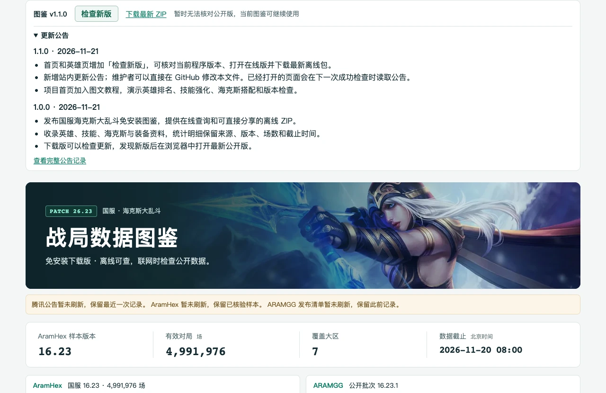

# 海克斯战局 · 国服海克斯大乱斗图鉴

一个给国服普通海克斯大乱斗玩家用的查询工具。选英雄前可以看谁常出场，点进英雄可以查一枚海克斯强化的是哪个技能，研究出装时可以对照装备场数、胜率和版本。网页、下载包和内置资料都可以直接分享。

**[直接打开在线版](https://jinyuany.github.io/hex-aram-cn/)**　·　**[下载免安装版 ZIP](https://github.com/JINYUANY/hex-aram-cn/raw/refs/heads/main/hex-aram-cn.zip)**　·　[查看更新公告](CHANGELOG.md)　·　[版本发布记录](https://github.com/JINYUANY/hex-aram-cn/releases)

## 第一次使用

| 想做什么 | 怎么打开 |
| --- | --- |
| 马上查询或在手机上使用 | 点「直接打开在线版」。把这个固定网址发给朋友，大家都能打开。 |
| 在电脑上离线使用 | 下载 ZIP，先解压，再双击 **海克斯战局.html**。使用桌面浏览器打开，离线也能搜索和筛选内置数据。 |
| 分享给朋友 | 发在线网址，或发送完整 ZIP。游戏账号、GitHub 账号、API Key 和额外的软件都无需准备。 |
| 查看某个英雄 | 在英雄榜输入英雄名、称号、常见简称或拼音。先点一行预览，再点已选英雄进入海克斯库。 |

这是独立的浏览器图鉴。数据来自公开的统计与游戏资料，使用时无需打开游戏或安装游戏内插件。

## 从一个英雄开始

### 1. 看出场和胜率，再决定查看谁

英雄榜可以切换胜率、出场指标和样本量，按从高到低或从低到高排列。出场占比以全部玩家出场人次为分母；「每百场出场」则以有效对局数为分母。小样本可以设置门槛，每页 20 项。

例如榜首选中亚索时，点一下第二行崔斯特，右侧会切到崔斯特的胜率、技能与常用强化。再点同一行就会进入崔斯特资料页。在详情里也可以沿当前榜单查看上一位、下一位。


### 2. 查具体强化的是哪个技能

进入英雄后点 **技能强化**，点被动、Q、W、E 或 R，再用「关联依据」筛选。例如查崔斯特的「回响施放」，选择 **Q** 和 **实战记录**，可以看到 **Q · 万能牌**，并在详情里打开对应录像。也可以从全局海克斯图鉴反查「哪些英雄有具体键位记录」。

固定键位、官方实例、实战记录、技能文本关联、额外获得的技能和历史移除各有标注。技能描述满足治疗、护盾、定身等条件时，会标为文本关联。指定键位缺少证据时显示待核实，历史修复保留公告或记录出处。


### 3. 从第一枚海克斯查到多枚搭配

1. 在英雄榜搜 **亚索**，进入海克斯库，选择 **鼓声暴起 低音轰鸣**。先看图标、效果、亚索持有率、全体持有率、两者的差值、该英雄的持有率排名和实际人次。
2. 在同一详情中点 **添加第二枚**。已选区保留两枚的图标与名称，点任意一枚可切换详情，点移除可换另一种搭配。一次可保留最多六枚。
3. 查看 **同时持有** 和 **常见后续搭配**。有同一名玩家同时持有完整组合的实测记录时才列场数。来源只公布部分组合时会注明范围。缺少记录时，页面会说明缺数。
4. 查看 **专属出装**。有该英雄、该强化条件下的装备样本才展示对应装备场数及允许展示的普通装备胜率。下方「不限强化」可用于查看英雄整体出装。

公开下载版使用免密钥来源。「含已选海克斯的三枚组合」可供已配置 ARAMGG 的自托管服务按需查询。来源没有提供两枚的统计时，三枚组合场数不能拆成两枚总场数。


## 还能查什么

| 栏目 | 主要内容 | 读数时要留意 |
| --- | --- | --- |
| 英雄数据 | 英雄图标、技能名称与说明、基础与成长属性、胜率、出场人次 | 榜单有数据来源和版本。两份来源不会直接相加。 |
| 海克斯图鉴 | 名称、图标、品质、效果、全局或单英雄持有率、同品质占比、覆盖英雄、英雄偏好差、跨版变化 | 持有率按对局结算统计。算「出现后多常被选」还需要三选一候选记录。 |
| 装备图鉴 | 装备属性、效果、合成、类别、持有人次、持有率和普通装备胜率 | 装备表使用自己的合格样本，可筛英雄及最低场数。 |
| 英雄出装 | 常用单件、三件套、样本量、对应版本及数据截止 | 若三件套或「命运之武器」首件传说装备沿用旧版，会标明历史样本。 |
| 版本与来源 | 腾讯版本公告及近期热修、AramHex 普通模式样本、ARAMGG 公开批次和最近成功核对时间 | 公告时间、数据截止、本站检查时间各自独立。活动样本单独统计。 |

随首份公开包收录的普通模式为客户端 **16.23**，对应国服公告 **26.23**。该批有 **173 名英雄、865 个英雄技能栏位、242 种强化目录项、197 件装备目录项**，其中 **237 种强化**有结算持有统计。有效样本 **4,991,976 场**，覆盖 7 个国服大区，截止 **2026-11-20 08:00（北京时间）**。后续请以页面当时显示的批次为准。[查阅上游批次](https://github.com/czgreat/aramhex-data/tree/data-v20/patches/16.23/normal)

## 一键检查新版与更新公告

页面顶部显示 **图鉴版本**。点 **检查新版** 即可核对公开版本，展开 **更新公告** 可以看每版新增、修复和数据变化。需要保留新版离线副本时，点旁边的 **下载最新 ZIP**。



| 更新对象 | 何时检查 | 用户会看到什么 |
| --- | --- | --- |
| 网站功能与界面 | 打开、恢复联网、回到页面，以及页面可见时每 5 分钟；也可手动检查 | 发现更新会在浏览器打开最新公开版。原 HTML 保留，可继续作为离线副本；需要时重新下载 ZIP。 |
| 英雄与装备等对局统计 | 页面打开及可见时按批次检查 | 公开来源发布合格样本后，页面更新统计并标出截止时间。网络或浏览器跨域限制导致读取失败时，保留最近有效或内置样本。 |
| 维护公告 | 随程序版本检查一并读取 | 维护者修改 GitHub 上的公告后，用户下次成功检查即可看到。断网时仍保留内置公告。 |

## 常见问题

**下载后提示打开压缩包，应该点哪一个文件？**  
先选「全部解压」或双击 ZIP 解压，再打开里面的「海克斯战局.html」。如果系统用编辑器打开，右键选择浏览器。手机优先用在线版。

**为什么版本公告已更新，榜单还是上个版本？**  
腾讯可以先发布公告，统计还要等足够的已结束对局与数据源发布。看「数据同步与 API」中每个来源的样本版本、截止时间与最近成功核对时间。公开数据源按批次更新。

**为什么有英雄胜率、装备胜率，没看到某枚海克斯的胜率榜？**  
Riot 的游戏政策禁止网站和应用展示强化胜率。本项目展示可公开的英雄胜率、普通装备胜率、强化持有人次、机制依据及有来源的搭配场数。[Riot 游戏政策](https://developer.riotgames.com/docs/lol#game-policy)

**显示「未取得场数」，是否表示这个组合没人用？**  
可能是来源没有发布该条件，或当前查询需要已授权的接口。页面会区分访问状态、历史记录和真正返回的组合。缺少样本也不能说明联动无效。

## 维护者怎样发布

**只发公告。** 在 GitHub 打开 [CHANGELOG.md](CHANGELOG.md)，点铅笔编辑，在最上面增加一节，再提交到 main。标题使用两个井号和版本、日期，正文每行用短横线。站内展示最近六节，完整记录保存在 GitHub。可按下面的模板填写：

```markdown
## 版本号 · 年-月-日

- 新增：玩家现在能做什么，以及从哪里进入。
- 修复：此前出现的具体问题和现在的行为。
- 数据：如有变动，写明来源、游戏版本、样本量和截止时间。
```

**发布新功能。** 从[项目源码 ZIP](https://github.com/JINYUANY/hex-aram-cn/raw/refs/heads/main/hex-aram-cn-source.zip)取源文件，修改代码，更新 `app-release.json` 的程序版本并填写公告。在 Node.js 22 或更高版本、Python 3 环境中依次运行：

```sh
node --test test/*.test.mjs
node scripts/build-download.mjs
python3 scripts/package-download.py
```

将 `dist/publish/` 中的文件一起提交到公开仓库 **main 根目录**。该目录含在线页、版本清单、两份 ZIP、项目说明、截图和公告。GitHub Pages 会从 main 根目录部署；部署完成后用「检查新版」验收。可在 GitHub Releases 给同一次提交打版本标签，保留逐版本说明和下载包。只存在于本机或其他私有站点的修改，需要先发布到这个仓库，用户端才会收到。

**自托管。** 解压源码后运行 `node server.mjs`，浏览器访问本机 `http://127.0.0.1:4187`。服务运行期间独立检查来源。需要 ARAMGG 国服英雄榜和已收录三枚组合时，可在服务端配置 `ARAMGG_API_KEY`。公开下载包无需填写密钥，也不会携带维护者的密钥。[ARAMGG 开发文档](https://data.dtodo.cn/api/v1/zh-CN/docs/cf-data-api.md)

## 数据与版权

[AramHex 国服统计](https://github.com/czgreat/aramhex-data) 按 [CC BY-NC 4.0](https://creativecommons.org/licenses/by-nc/4.0/deed.zh-hans) 开放，使用时需署名并限非商业用途。本项目整理统计表、换算比例并标注样本口径。[腾讯版本公告](https://lol.qq.com/gicp/news/423/2/1334/1.html) 用于跟踪国服补丁。[Riot Data Dragon](https://developer.riotgames.com/docs/lol#data-dragon) 与 [CommunityDragon](https://raw.communitydragon.org/) 提供游戏资料。英雄名称、图标与图像等权利归各自权利人。

海克斯战局 is not endorsed by Riot Games and does not reflect the views or opinions of Riot Games or anyone officially involved in producing or managing Riot Games properties. Riot Games and all associated properties are trademarks or registered trademarks of Riot Games, Inc.
