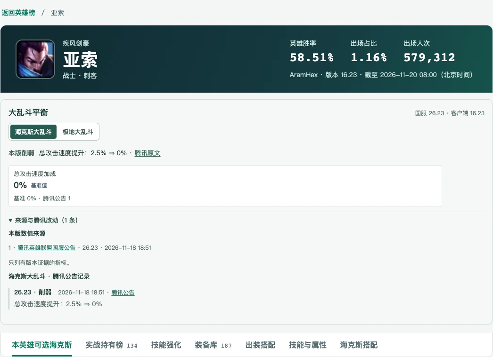
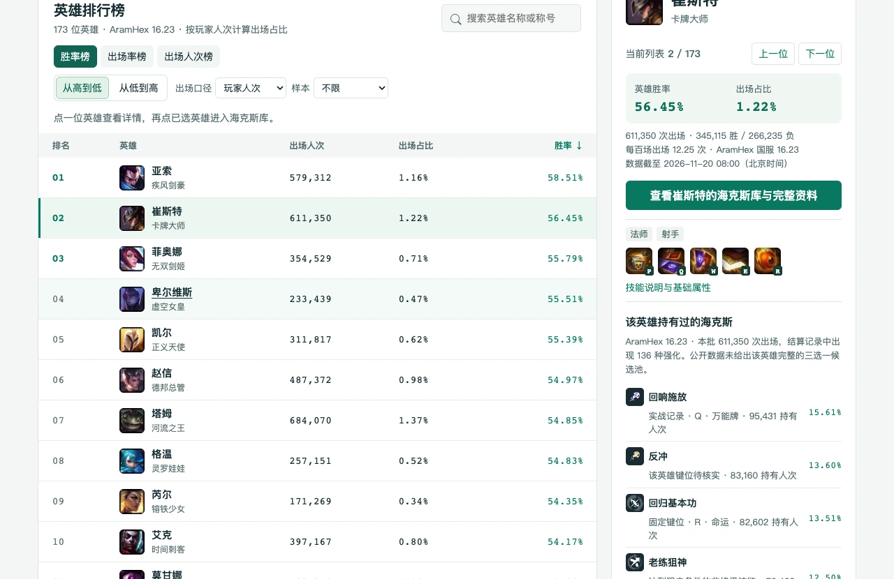
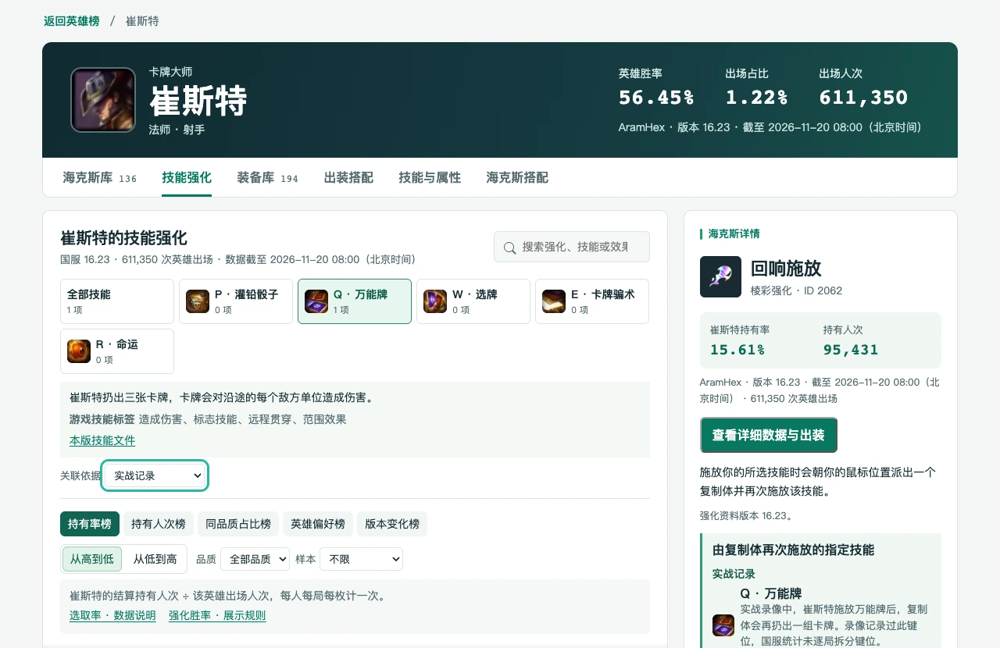
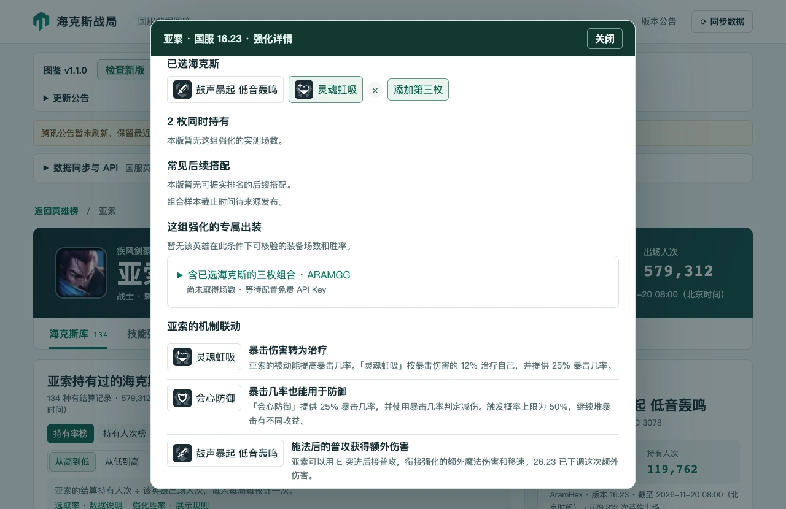
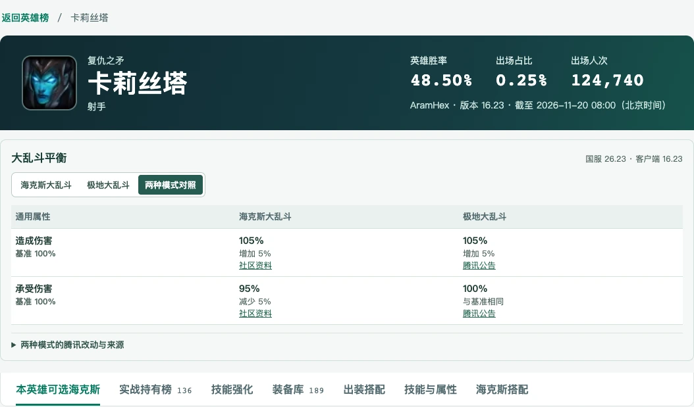
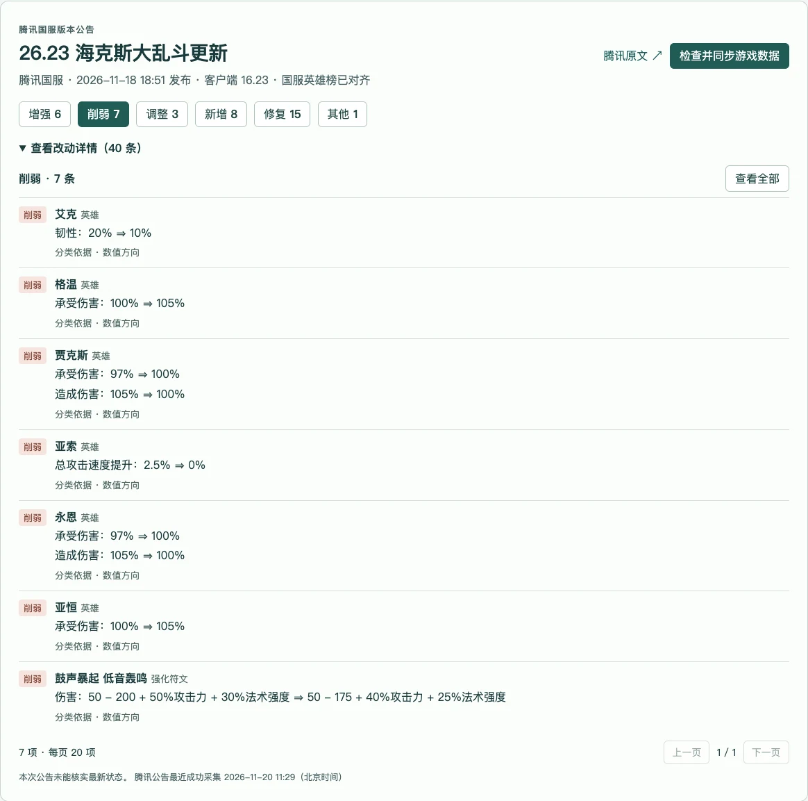
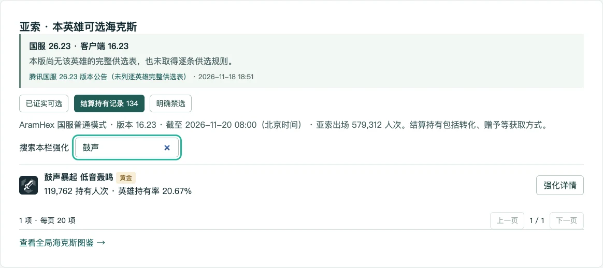

# 海克斯战局 · 国服大乱斗图鉴

选英雄时查两种大乱斗的平衡改动，选完英雄后查技能、海克斯和出装。数据以国服海克斯大乱斗普通模式的公开样本为主。每个统计面板保留自己的来源、版本、分母和截止时间。

**[直接打开查询页](https://jinyuany.github.io/hex-aram-cn/)　·　[下载免安装 ZIP](https://github.com/JINYUANY/hex-aram-cn/releases/latest/download/hex-aram-cn.zip)　·　[查看更新公告](CHANGELOG.md)**

## 第一次使用

- **在手机或电脑上在线查**　打开查询页，输入英雄名或常见简称。可直接分享某位英雄的资料页地址。
- **下载使用**　解压 ZIP，用浏览器打开 **海克斯战局.html**。玩家无需注册、登录或填写 API Key。可以把 ZIP 原样发给朋友。
- **离线查**　使用包内自带的排名、图标、技能和公告。新批次和外部原文需要联网。浏览器允许存储时会保留已经取得的数据。

## 从亚索开始查

1. 在「战局数据图鉴 → 英雄数据」搜索 **亚索**。点一次英雄行，选中框和详情随之切换。再点同一位英雄进入他的海克斯库。也可以直接使用预览里的栏目入口。
2. 在 **大乱斗平衡** 里切换「海克斯大乱斗」和「极地大乱斗」。先看当前版本有出处的数值，再按日期查看腾讯对这名英雄做过的调整。例如 26.23 海克斯公告记载亚索的总攻击速度提升从 2.5% 调至 0%。点「两种模式对照」可以看到同一项在极地大乱斗为 +2.5%。进入英雄页后，复制地址可以分享当前模式或对照视图。[试查亚索的两种模式](https://jinyuany.github.io/hex-aram-cn/#?hero=157&view=pool&balance=compare)
3. 进入 **本英雄可选海克斯**。分别查看来源明确的可选、禁选以及实战持有记录。「实战持有」包括结算时获得或转化的强化。完整供选规则有独立的来源与覆盖标记。点「腾讯供选变更」可以搜索公告当时的英雄、键位、形态或技能段数，例如波比 W 的「回响施放」。每条附国服版本、北京时间及腾讯原文。打开「腾讯技能交互」可查更具体的修复，例如 26.23 辛德拉 E「弱者退散」和「老练狙神」。切换到基兰可查 26.18 基兰「扳机炼狱」的历史排除记录。
4. 进入 **英雄海克斯库**，查找「鼓声暴起」等强化。点第一枚即可查看图标、效果、品质、亚索的持有人次和分母。继续选择第二枚可查同局场数。只有来源给出完全相同组合的真实场数，才会出现对应结果。排行榜按同局持有场数排序。若公开源只发布上一版本，历史栏会保留该样本的来源与截止时间。当前公开的 AramHex 16.23 第 20 批只有各枚的持有人次。

5. 打开 **出装搭配 → 前 5% 玩家 · 三件套**，查看该评分分组内前三件传说装备的购买顺序。每行列出场数和可展示的胜率。在「命运之武器」的强化详情里，也可分别查看两组玩家的首件传说装备及各自的场数。全体玩家与分组数据各有统计窗口，例如 16.23 的英雄榜可以同时展示截至 11 月 17 日的 16.22 三件套。[AramHex 分组与样本定义](https://github.com/czgreat/aramhex-data)

查看英雄榜、技能与搭配的操作图

**英雄榜**　切换胜率、出场、样本量和排序方向，在选中行与详情之间浏览。

**技能强化**　在英雄资料中按被动、Q、W、E、R 或证据类型筛选，查看强化指向的技能及依据。当版本变更时，模式文件仍可识别具名的固定键位。其他指定技能强化需等待可核实的逐英雄记录。

**搭配查询**　先选第一枚，再加条件。页面会标明已选组合、版本、样本和可取得的装备记录。

在英雄详情点 **召唤师技能**，可查「闪现＋标记」等双技能组合的场数。切换「单个技能」可看该英雄有多少场带了闪现。两种视图均以该英雄有双技能记录的出场为分母，按场数降序排列。每场贡献一种组合、两个单技能记录。页面标注数据版本、批次、截止时间及原表链接，下载版也可离线查内置样本。

## 通用属性和专属技能怎么读

**卡莉丝塔的承受伤害**　在 26.23 的对照页，海克斯大乱斗为 95%，极地大乱斗为 100%。两者都以 100% 为基准。点数值旁边的来源可以查对应模式原文。[打开卡莉丝塔对照页](https://jinyuany.github.io/hex-aram-cn/#?hero=429&view=pool&balance=compare)

**沃利贝尔的 E「霹天雳地」**　26.23 海克斯模式资料记载，护盾的最大生命值加成由 11% 调整为 14%。这条记录适用于这个技能；即使通用属性待核实，详情页也会单独列出该技能及来源。本版海克斯技能修正覆盖 17 位英雄，共 35 条。[查看沃利贝尔的技能修正](https://jinyuany.github.io/hex-aram-cn/#?hero=106&view=skills)

## 各个栏目能查什么

| 栏目 | 可查内容 | 阅读时留意 |
| --- | --- | --- |
| 英雄榜与资料 | 英雄胜率、出场占比、出场人次、技能、基础属性，按英雄跳到海克斯、装备与搭配 | 两家都有国服英雄样本时优先使用更新的游戏版本。同版本优先用有分母和截止时间的 AramHex |
| 大乱斗平衡 | 当前模式可核实的英雄修正、数值和按日期排列的官方改动 | 切到「两种模式对照」可以逐属性并排看数值，单侧待核实时保留空缺。技能专属修正另列具体技能和条件。26.23 包内有海克斯 66 位、极地 160 位英雄的可核实数值，覆盖人数随来源更新。某项缺记录时显示待核实 |
| 海克斯图鉴 | 中文名称、图标、效果、品质、全局及单英雄持有率、持有人次、覆盖英雄和可用的批次趋势 | 持有率用结算持有人次作分子。三选一选取率另需候选出现次数 |
| 逐英雄供选表 | 已证实可选、明确禁选、实战持有，可按名称、品质筛选 | 来源只列部分规则时，未列出的强化状态未知 |
| 装备与出装 | 物品图标、属性、结算持有率、普通装备持有时胜率、英雄成装、核心三件套 | 各表可能使用不同的场数与版本；条件出装只列有该条件的原表 |
| 海克斯搭配 | 已核实的同局组合场数、适用条件、英雄专属机制联动 | 需要相同英雄、相同模式和组合记录。单枚持有率无法推算两枚共现 |
| 更新与公告 | 腾讯平衡调整、热修、样本批次、程序更新 | 公告发布、样本截止、来源检查、程序发布分别标注 |

Riot 的开发者规则限制展示强化胜率。因此单枚、按英雄筛选和多枚海克斯均不提供胜率排名。普通英雄胜率、符合展示规则的装备统计与联动机制可在对应栏目查看。[Riot 游戏政策](https://developer.riotgames.com/docs/lol#game-policy)

## 点「更新」会发生什么

**更新游戏数据**　在首页点「检查并同步游戏数据」，再点「查看逐项结果」。腾讯先发公告时可先读改动；AramHex 新样本发布后更新统计；按版本发布的英雄技能、海克斯中文效果与装备资料分别核对。部分表沿用旧样本时会标出其实际版本。公开源暂时不可达时，可继续查看已保存的资料。

**更新应用本身**　打开页面、恢复联网或页面可见期间每五分钟核对公开版，也可点「检查新版」。下载版发现新版会自动打开新页面。看到“本版已保存”后，收藏该网址即可在同一浏览器中离线使用已缓存的新版。清理站点数据会清除缓存，原 ZIP 可继续离线使用。[最新程序版本与下载记录](https://github.com/JINYUANY/hex-aram-cn/releases)

**查看历史**　在海克斯大乱斗更新区点「历史版本公告」，可按发布时间查看腾讯原文和已收录的海克斯改动，每页 20 项。程序自身的功能变化在页首「图鉴程序更新历史」。

**核对样本**　点击「检查并同步游戏数据」后，查看本次回执中的版本、批次、对局数与截止时间。「查看逐项结果」列出各类资料，包括仍在使用历史样本的装备组合。

**多久能看到新内容**　页面打开且可见时每 5 分钟检查，也可手动检查。本机直接核对腾讯国服新闻目录。公告标题与原文可以先到，改动明细与对局统计分别补齐。正文镜像由 GitHub Actions 每 15 分钟计划采集一次，执行可能延迟。AramHex 按自己的批次发布，ARAMGG 的公开清单和授权统计分别判断。手动检查能取得来源当时已发布、当前网络可读且通过版本校验的内容。国服全量对局及零延迟更新没有可验证的公开承诺。[采集运行记录](https://github.com/JINYUANY/hex-aram-cn/actions/workflows/sync-data.yml)

查看公告与逐英雄供选栏目的操作图

## 数据从哪里来

- **腾讯英雄联盟国服**提供版本号、公告和热修原文。页面使用国服公告号与客户端版本，如公告 26.23 对应客户端 16.23。[腾讯更新公告目录](https://lol.qq.com/gicp/news/423/2/1334/1.html)
- **AramHex** 提供国服普通模式匿名汇总快照。本项目对数据做筛选、中文呈现、比率换算和分栏，并保留原样本窗口。原数据遵循 CC BY-NC 4.0，适用署名和非商业约束。[原始数据](https://github.com/czgreat/aramhex-data) · [许可条款](https://creativecommons.org/licenses/by-nc/4.0/deed.zh-hans)
- **ARAMGG** 提供公开版本清单。取得授权后可接入第二份国服英雄榜，支持在线服务按英雄查询该来源提供的三强化场数。玩家无需申请密钥。[开发者入口](https://data.dtodo.cn/developer.html)
- **英雄联盟 Wiki** 提供按版本核对的极地大乱斗资料和海克斯模式修正。本项目对具名数值做中文整理，并按腾讯国服公告校正对应指标。每项社区资料可追溯到固定修订。相关衍生数据按同一许可提供。[英雄联盟 Wiki](https://wiki.leagueoflegends.com/en-us/ARAM:_Mayhem) · [CC BY-SA 3.0](https://creativecommons.org/licenses/by-sa/3.0/)
- **Riot Data Dragon 与 CommunityDragon** 提供版本化的中文英雄、技能、装备与游戏资源。平衡数值在英雄详情内单列其实际证据和适用模式。[Data Dragon](https://developer.riotgames.com/docs/lol#data-dragon) · [CommunityDragon 档案](https://raw.communitydragon.org/)

## 公告、反馈与维护

玩家可在站内「更新公告」查看功能变化。上报数据问题时，请附英雄、玩法、页面显示的版本和截止时间，最好附原文链接。[更新记录](CHANGELOG.md) · [反馈问题](https://github.com/JINYUANY/hex-aram-cn/issues)

维护者可以查看自动采集、可选接口配置、测试、构建和发布流程。[维护手册](MAINTENANCE.md) · [下载项目源码](https://github.com/JINYUANY/hex-aram-cn/raw/refs/heads/main/hex-aram-cn-source.zip)

海克斯战局为玩家制作的资料查询工具，独立在浏览器内运行。英雄、装备、强化名称和相关图像归各自权利人所有。

Hex ARAM CN is not endorsed by Riot Games and does not reflect the views or opinions of Riot Games or anyone officially involved in producing or managing Riot Games properties. Riot Games, and all associated properties are trademarks or registered trademarks of Riot Games, Inc.
